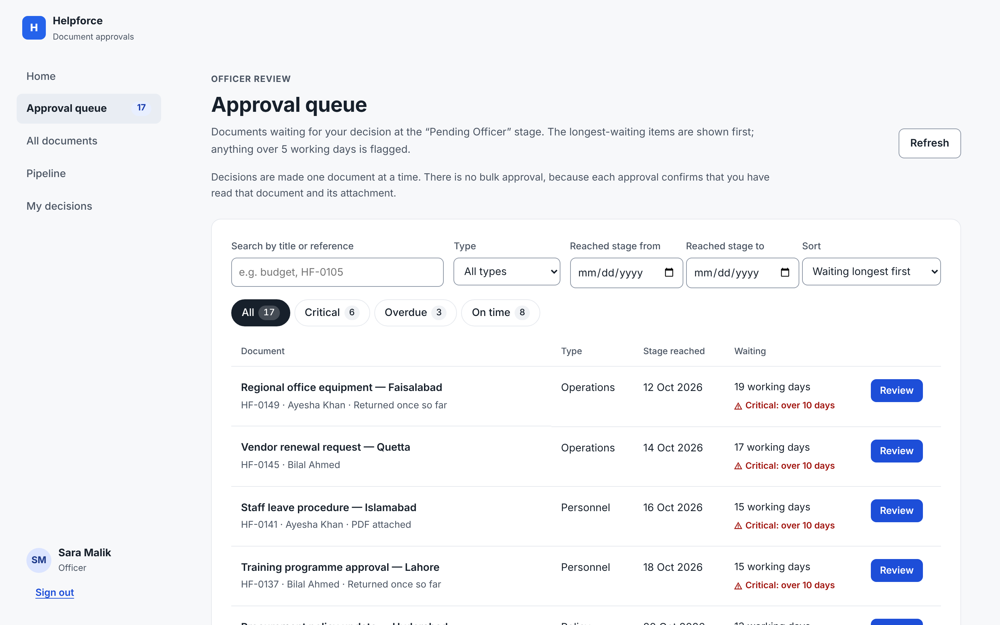
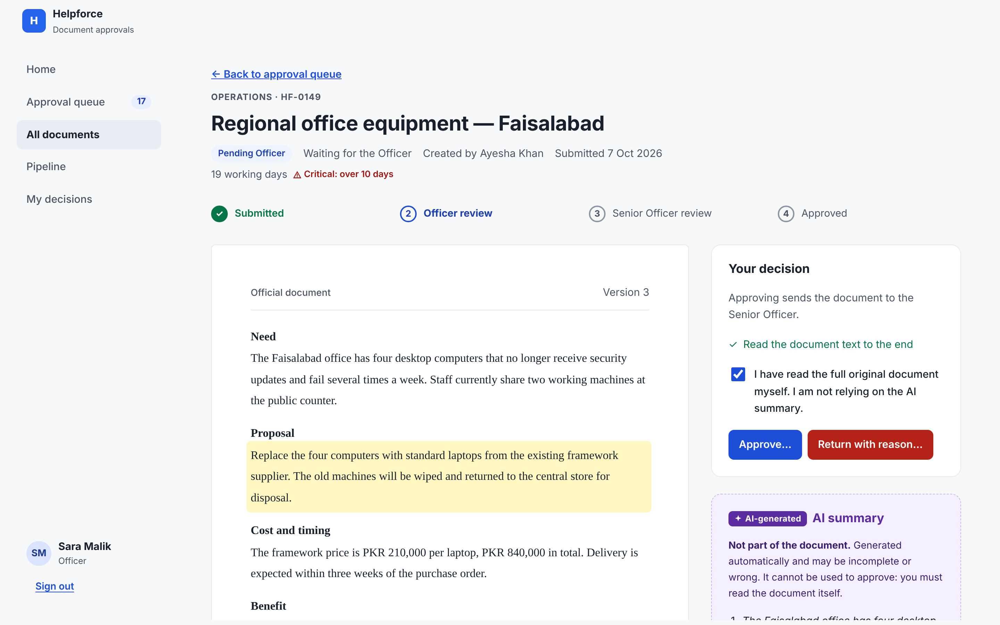
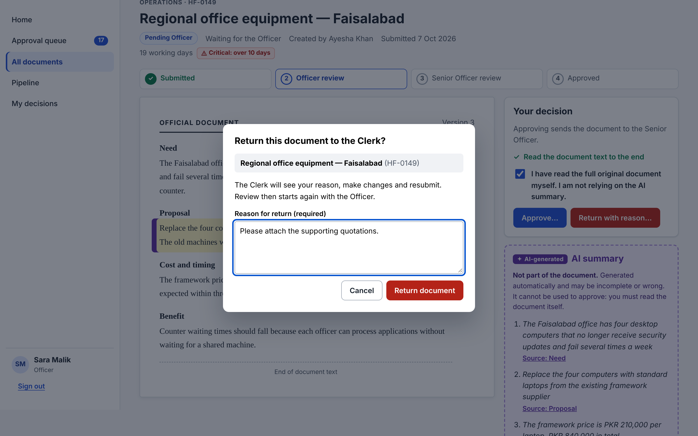
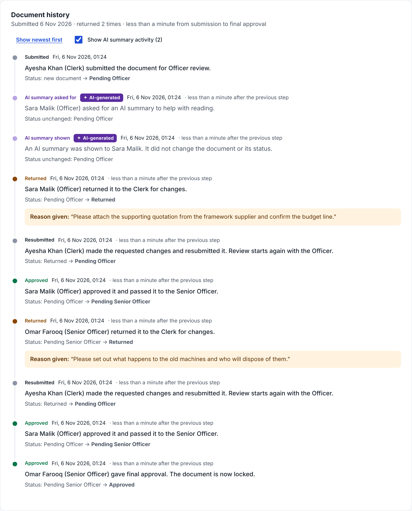
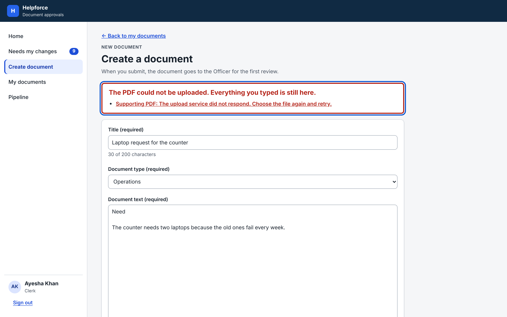
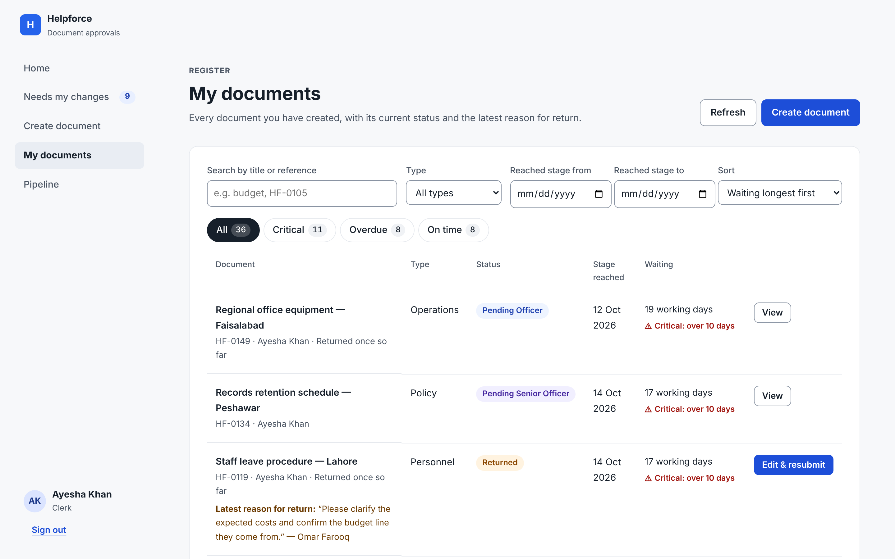

# Helpforce document approvals

Clerk → Officer → Senior Officer approvals with a local mock API (Next.js 16, React 19, TypeScript). Fully offline: system fonts, bundled PDF.js worker, no external requests (verified with all non-localhost traffic blocked).

**Run** (Node 20.9+): `npm install && npm run dev`, then open http://localhost:3000 and pick an account: Ayesha Khan or Bilal Ahmed (Clerks), Sara Malik (Officer), Omar Farooq (Senior Officer). **Tests:** `npm test` runs 48 Vitest tests (rules, queue, seed, API errors, UI in jsdom). `npm run test:e2e` runs 5 Playwright tests on a production build (approval, 409 conflict, 403, failed upload, expired session, axe-core and no external requests; first run `npx playwright install chromium`). Lint and build pass. Data is in memory and resets on restart. Screenshots are at the end.

## Design decisions
- **Server enforces everything.** `lib/api-handler.ts` checks session, role, ownership, status and the version the user saw; hiding buttons is only a convenience. Rules are pure functions in `lib/domain.ts`.
- **Queue for 60+ items:** longest-waiting first; search, type and date-reached filters; sort by waiting time or title; On time (≤5 working days) / Overdue / Critical (>10) groups with counts, flagged in text not just colour; 15 per page; **Review next document** after each decision. Every document has its own URL.
- **No bulk approval.** An approval asserts "I read this document and its attachment"; a batch would make that untrue for irreversible official decisions. Speed comes from the ordered queue and "Review next".
- **Safe irreversible actions:** Approve/Return unlock only after scrolling to the end of the text, viewing every PDF page and ticking "I read the original myself"; both confirm in a dialog (focus on Cancel); returning needs a reason. Approved documents show a lock, no edit controls, and the API answers 409.
- **Audit history for a manager:** one plain sentence per step with name and role ("Sara Malik (Officer) approved it and passed it to the Senior Officer"), date, time since the previous step, status change and reason. Oldest or newest first; AI activity can be hidden.

## Permission and conflict errors
One client (`lib/client/api.ts`) and one handler (`components/app-provider.tsx`):
- **401:** back to sign-in with an explanation, then to the same page.
- **403 / 409:** a plain explanation ("Someone else changed this document… the latest version is now shown"), then session, list and document reload and the reading confirmation resets.
- **Other failures:** shown in place, with a retry.
- **Nothing typed is lost:** the Clerk form saves a local draft on every change, so a failed upload, expired session or reload keeps the text; upload errors show at the file field.
- **Demonstrate:** open one pending document in two tabs and approve it in one, then act in the other (409). As Ayesha, open `/documents/HF-0105` (403). Attach a PDF named `fail-upload.pdf` (upload fails, text kept).

## AI summary
Approvers get **Summarise** in a purple dashed panel labelled "AI-generated · Not part of the document", apart from the paper-styled original. The rule-based mock takes 2–4 s and fails every 5th call. Reading and deciding continue while it loads; it can be cancelled, and leaving the page aborts it so a late reply never lands on another document. Each point links to its source section, which is scrolled to, highlighted and focused. Every request, success and failure is audited.

**Approving on the summary alone is prevented by design, not just by a warning:** the decision checklist counts only the original text and every PDF page; the summary counts for nothing, and the confirmation reads "I am not relying on the AI summary". This proves the document was shown, not understood, which is an accepted limit.

## Assumptions
Working days skip weekends, not holidays. Approvers see all documents but decide only at their stage; Clerks see only their own. Resubmitting without a file keeps the existing PDF. No passwords (demo).

## With another day
Persist data (SQLite); run both test suites in CI; public holidays in working days; a printable audit report for managers; screen-reader testing with NVDA/VoiceOver beyond automated checks.

## Screenshots

**Approval queue:** longest-waiting first, filters, waiting-time groups and overdue flags.

**Document review:** the official text, the decision checklist, and the AI summary with a cited paragraph highlighted.

**Confirming a return:** a reason is required before the document goes back to the Clerk.

**Audit history:** one document's full life: created, returned by the Officer, resubmitted, returned by the Senior Officer, resubmitted, then final approval, with roles, timing, status changes and reasons.

**Failed upload:** the error is explained and everything typed is kept.

**Clerk's documents:** status, waiting time and the latest reason for return.

